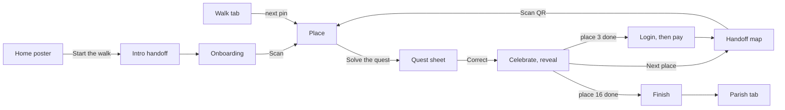

# Lakaw Katedral: Design Spec (Color, UX, Screens)

**Project:** Lakaw Katedral  
**Companion to:** [`SPEC.md`](./SPEC.md) (product and technical), [`GAME-FLOW.md`](./GAME-FLOW.md) (game shape), [`HANDOVER-PRODUCTION.md`](./HANDOVER-PRODUCTION.md) (build plan)  
**Status:** Accepted (place-loop shell shipped)  
**Date:** 2026-11-12  
**Scope:** Mobile PWA visual system and screen UX for the walk

This document is the source of truth for tokens, type, chrome, and the per-screen inventory. The reference for look and feel is [`/prototypes/place-loop.html`](../public/prototypes/place-loop.html). Where it conflicts with older UI notes in `SPEC.md`, this document wins.

---

## 1. Design intent

Warm welcome for an outdoor QR walk through Naga Metropolitan Cathedral. Color should feel like standing in front of the cream facade at noon: grounded, inviting, readable in sun. Not a cool museum app, not a dark liturgy app, not a transit map. The structure borrows from a language-learning game: three tabs, a map board, one short lesson per place, and a quest that rewards looking.

**Inspiration:** cathedral facade (cream stone, wood doors, terracotta pavement). Values are inspired for UI readability, not eyedropped from a photo.

## 1.1 Language

Plain words around real names. Visitor-facing copy is about Grade 3 level ("place" not "stop", "walk" not "journey", "give" and "help" not "donate" and "support"), but names and key terms stay exact: Naga Metropolitan Cathedral, Archdiocese of Cáceres, parish, façade, and so on, each explained in simple words the first time. Full rules: [`SPEC.md` section 3.1](./SPEC.md). Internal docs and code keep the words stop, POI and journey.

---

## 2. Color system

### 2.1 Decisions

| Decision | Choice |
|----------|--------|
| Appearance | Light only. No dark mode. |
| Neutrals | Soft cream canvas. No cool blue-gray backgrounds. |
| Primary CTA | Mid-brick terracotta with a solid darker lip. |
| Secondary | Wood brown (nav weight, quiet text buttons). |
| Success | Muted green only (done, right answer). |
| Danger | Clear red (errors, wrong answer). Must not look like a CTA. |
| Ceremonial | Gold, used sparingly: hints, rules, scan corners. |
| Sky blue | Banned from chrome. |

### 2.2 Token table

Implemented in `src/app/globals.css` (`:root`). Keep `manifest.ts` and viewport `themeColor` in sync.

| Role | Token | Hex | Use |
|------|-------|-----|-----|
| Canvas | `--background` | `#f4eee4` | App background, quest sheet |
| Sheet | `--surface` | `#faf6ef` | Choices, chips, fields, map chip |
| Ink | `--foreground` | `#2a211c` | Primary text, switcher panel |
| Quiet ink | `--muted-fg` | `#6b5e54` | Secondary text |
| Line | `--border` | `#e0d4c4` | Dividers, tab bar top border, control outlines |
| Muted | `--muted` | `#9a8b7c` | Disabled / placeholder tone |
| CTA | `--accent` | `#b85c38` | Primary buttons, next pin, "Your quest" |
| CTA lip | `--accent-depth` | `#7a3f28` | Solid offset shadow under CTAs |
| On CTA | `--accent-fg` | `#fffaf5` | Text on terracotta |
| Wood | `--stone` | `#6b4a35` | Quiet actions, back chevron |
| Wood soft | `--stone-light` | `#e8d8c8` | Soft chips, progress track |
| Gold | `--ceremonial` | `#ecbe41` | Hint ring, gate rule |
| Success | `--success` | `#4f6b4a` | Done pin, right answer |
| Success lip | `--success-depth` | `#314832` | Lip under a right answer |
| Danger | `--danger` | `#b33b2e` | Errors only |

Controls (choice, chip, order card, stepper) use a neutral lip, `#d3c4b2`.

### 2.3 Surfaces

- Default world is flat cream (`--background`).
- Lighter ivory (`--surface`) is for tappable controls and fields.
- No white card grids, no card treatment in heroes.
- **Solid offset shadows, no blur.** Primary CTA: `4px 5px 0 var(--accent-depth)`. Choices, chips, order cards, steppers: `3px 4px 0` lip. Press translates the control into its lip and drops the shadow to `0`. No soft multi-layer glows as an affordance.

### 2.4 Contrast

Aim for WCAG AA on text and CTAs. Prefer mid-brick terracotta over muted clay so primary actions stay readable outdoors.

---

## 3. Type and layout

| Role | Font | Notes |
|------|------|-------|
| Display | EB Garamond 500/600 (`--font-display`) | Titles, reveal line, page headings. Utility `font-display`. |
| Story body | Source Serif 4 (`--font-body`) | Prose, ledes, quest question |
| UI | Source Sans 3 (`--font-ui`, also Tailwind `font-sans`) | Tabs, buttons, chips, forms, notes |

Fonts load in `src/app/layout.tsx` with `next/font/google`.

- **One phone-sized column.** `.app-frame` (max 30rem, `100dvh`, centered on wide screens) wraps every `(tour)` route. Each screen is a `.view`.
- **Shared inset:** `--page-x: 16px` on shells, docks, sheets, and the tab bar.
- Styles for the shell live in `src/app/walk.css` (ported from the prototype). `globals.css` keeps tokens, motion keyframes, the start-walk handoff, the confirm dialog, the correct celebrate, and print.
- Primary CTA: full width, 56px min height, 16px radius. Text button (`.text-btn`) for quiet actions.

---

## 4. Chrome and navigation

| Rule | Choice |
|------|--------|
| Tab bar | **Walk, Parish, Profile.** Top border, icon plus label, active in terracotta. Only on `/walk`, `/parish`, `/you`. |
| No tabs on | Home, onboarding, place, handoff, scan, login, pay, finish, terms |
| Map access | Walk tab. On a place or handoff, the **N of 16** chip goes to Walk. |
| Church switcher | From the Walk logo. Naga is on. Others are listed as Soon. Not a fourth tab. |
| Back | A chevron in the top bar on place, handoff, and terms. Place goes to Walk. Handoff climbs area, compound, then the last place. |
| Points | Stub on Walk: solved × 10, next to the coins icon. |

---

## 5. Flow principles

1. **In order:** only the next unsolved place can be solved. A solved place reopens as full media, story, and reveal, with no quest. Opening any other unsolved place by link or scan goes to Home if the walk has not started, otherwise to Walk with a "next up" note. The scanner stays on the camera with a warm note instead of leaving.
2. **Scan opens the place,** never the map first.
3. **Story first, then the quest.** Media, one lead line, and the prose story are on the page before the quest. A quest is answered by looking or from that story. No typing, no keyboard.
4. **Free then paid:** places 1 to 3 are free. Place 4 and after need a saved login, then a ₱50 payment. Internal builds can confirm locally (`TEMP_PAY_UNLOCK`).
5. **Offline:** the whole tour is cached when the service worker installs. Giving needs network.
6. **Start over:** from Profile and Finish, with a confirm before clearing progress.

---

## 6. Screen inventory

### 6.1 Home (`/`): poster

- Full-bleed muted loop (`/video/entrance.mp4`), steward crest upper left, brand wordmark, one line ("16 places. Learn each one. Finish for a prize."), terms link, **Start the walk**.
- Fresh visit only. Once progress is read, a started walk goes to `/walk` and a finished one to `/finish`. Text and dock stay hidden until then, so a returning visitor never sees "Start the walk" flash.
- **Start the walk** plays the intro handoff (terracotta screen, partner marks, count to 100, brand), then `/onboarding`.

### 6.2 Onboarding (`/onboarding`)

- "Start at the entrance". Compound map with pin 1 and the entrance photo callout. **Scan the entrance QR**. Trial mode adds a quiet **Skip the scan**.
- Skips itself for anyone already walking.

### 6.3 Walk (`/walk`): tab

- Top bar: church logo with a caret (opens the switcher) and the points stub.
- Compound map with all 16 pins. States: **done** (green check), **next** (terracotta with ring), **locked** (grey).
- Tap done: reread the place. Tap next: go there (login or pay first when gated). Tap locked: a warm "not yet, next up" note.
- No scan dock and no explainer at the bottom.
- The container keeps the map at 280:360 (container query units) so pin percentages land on the map.

### 6.4 Place (`/s/[slug]`)

Top to bottom:

1. Top bar: back chevron (to Walk), short place title, **N of 16** chip.
2. Teach media: muted loop with a **Sound** badge, or a still.
3. The lead line (`about`), then **The story** as prose (`aboutMore`).
4. After a solve, and on every reopen: media (still), the reveal line (display type), then the full story with the lead line first.
5. Dock: **Solve the quest** (next place only). After a solve: **Next place**, **Continue the walk** (an older place), or **Finish the walk** (place 16).

**Quest sheet:** rises full width over the place on `--background`, soft dark overlay, top radii only. Header "Your quest" in accent beside a close. Action line, look and **question**, feedback line, answer controls, **Check**. The dock stays in layout under the sheet. The panel is focused with `preventScroll`.

| Type | Controls |
|------|----------|
| `cloze` | Sentence with a blank, tap a chip to fill it |
| `order` | Three cards, up and down buttons |
| `count` | Stepper, minus and plus |
| `select_all` | Tap every true chip |
| `choice` | Two-column grid (fallback) |

A wrong Check shakes the panel, shows the nudge for that miss, and clears the pick. After 3 misses a hint highlights the answer in gold (order and count fill in the answer). A right Check locks the sheet and plays the **Correct** celebrate (dim wash, green sticker, confetti, about 1.8 s). Then the place is marked solved, the sheet closes, and the reveal shows without jumping the scroll.

### 6.5 Handoff (`/handoff`)

- Next place on its **area map**, with the route from the place just finished, a green "from" pin, and a terracotta "next" pin.
- Top bar label: the area name. **Back** goes to the compound map, then to the last place. Tap the next pin on the compound map to drill into the area. Tap it on the area map to scan.
- Dock: **Scan QR**. Trial mode adds **Skip the scan**.
- Places after the free three go through login and pay first.

### 6.6 Scan (`/scan`)

- Full-bleed camera, brand wash, gold finder corners, status label (Scanning, Code found), a note line, close, and a quiet **Skip the scan** in trial mode.
- Valid next place: opens it (or the gate). Any other valid place: stays on the camera with "That is place N. Your next place is …". Unknown codes: a plain rejection note.

### 6.7 Parish (`/parish`): tab

- Hero photo, then (once the walk is done) **Your surprise prize**.
- **Help the parish:** amounts ₱20, ₱50, ₱100, ₱500, a custom field (minimum ₱20), **Give**. The stub provider confirms; the button reads **Thank you** for a moment.
- **While you are here:** Offer a Mass, Holy Family Chapel, Souvenir shop.

### 6.8 Profile (`/you`): tab

- Bernardo avatar banner, name, **Your progress** (N of 16, bar, points), and **Log in to save** when logged out (or the saved email when logged in). Quiet **Start over**.

### 6.9 Login and pay (`/login`, `/pay`)

- Hero, kicker, title, copy, then the dock (primary action and **Back to the walk**).
- Login: email and password (8+ characters), "The first three places are free". Logging in from Profile returns there; from a gate it goes on to pay.
- Pay: ₱50 price and the saved email. A confirmed payment sets `paid` and returns the visitor to where they were headed (a place or the handoff).

### 6.10 Finish (`/finish`)

- Prize hero, "You finished the walk", one line about the prize, **Help the parish** (to Parish), quiet **Start over**. If the walk is not finished it sends the visitor back to Walk.

### 6.11 Terms and offline

- `/terms` and `/~offline` use the same top bar and dock as the rest.
- Offline: "No internet", the walk saves after the first load, giving needs internet, **Go to the start**.

### 6.12 Redirects

`/map` goes to `/walk`. `/donate` and `/thank-you` go to `/parish`. `/qr` (printable codes) is unchanged and sits outside the app frame.

---

## 7. Motion

Motion gives presence and hierarchy, never decoration. All of it is off under `prefers-reduced-motion` (content just appears).

**Easing tokens**

| Token | Curve | Use |
|-------|-------|-----|
| `--ease-out` | `cubic-bezier(0.22, 1, 0.36, 1)` | Anything arriving: fast start, soft landing |
| `--ease-spring` | `cubic-bezier(0.34, 1.56, 0.64, 1)` | Small overshoot: sticker, sparks |
| `--ease-in` | `cubic-bezier(0.4, 0, 1, 1)` | Anything leaving |

**Inventory**

| Where | Motion | Timing |
|-------|--------|--------|
| Quest sheet | Rises from the bottom, overlay fades in; closing is faster | 420 ms open, 280 ms close |
| Wrong answer | Panel shakes, wrong marks hold, then reset | 380 ms shake, 420 ms marks |
| Correct | Dim wash, sticker pops in, confetti, then sticker leaves | 1.8 s |
| Reveal | Rises in on the place | 420 ms |
| Switcher | Panel rises in under the logo | 240 ms |
| Next pin | Soft pulse ring on Onboarding and Handoff | 1.6 s loop |
| Buttons and controls | Press translates into the lip | 90 ms |
| Start the walk | Terracotta mask opens, count 0 to 100, brand pulse, title holds, zoom out into onboarding. Reduced motion skips it. | about 8 s |

**Rules**

- Animate `transform` and `opacity` first.
- Page content is real HTML first, so a slow phone still shows it.
- Avoid decorative glow, pill clusters, and floating badges on hero media.
- There are no page-to-page view transitions. Screens swap.

---

## 8. Overrides to product spec

| Topic | Older `SPEC.md` / earlier design | This design spec |
|-------|-----------------|------------------|
| Chrome | No tab bar, map chat-head | Walk, Parish, Profile tabs |
| Map | Bubble from the dock | Walk tab board |
| Quest | Typed answer, dark card | Tap-only light sheet |
| Place | Hero, article, Read more | Media, prose story, Solve the quest |
| Finish | Gift page with success modal | Short bridge into Parish |
| Donate amounts | Custom only | Presets plus custom, minimum ₱20 |
| Free places | n/a | First 3, then login and ₱50 |
| Type | One display and one body | EB Garamond, Source Serif 4, Source Sans 3 |

Update `SPEC.md` screen notes to match when editing product docs.

---

## 9. Implementation checklist

- [x] Tokens, fonts, and solid-offset controls from the prototype
- [x] Tab shell (Walk, Parish, Profile); no tabs elsewhere
- [x] Walk board with 16 pins, church switcher, points stub
- [x] Place: story first, light quest sheet, five tap formats, celebrate, reveal
- [x] Only the next place can be solved; solved places reopen without a quest
- [x] Handoff with area and compound maps; real camera scan
- [x] Login (3 free places), pay (temporary internal unlock), finish, parish, profile
- [x] Typing, dark quest card, and map bubble removed
- [ ] Confirm all 16 quest answers on site with the parish
- [ ] Replace the temporary pay unlock with SukiPay
